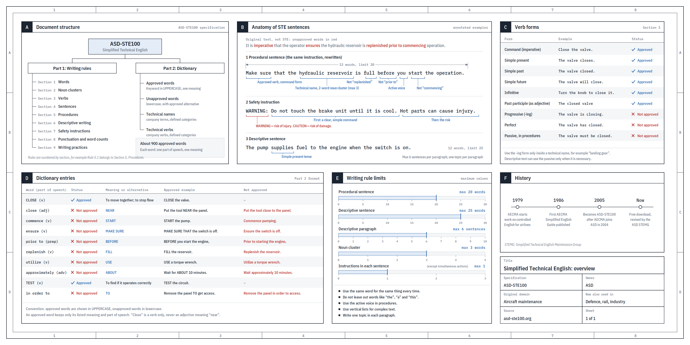

# Prose

[](LICENSE)

Prose is one agent skill for every text a person reads: single documents, bulk skimmable text, and PR/commit text. Much of its body is reused verbatim from Dodaios/ste80-humanizer (MIT) - see [PROVENANCE.md](PROVENANCE.md) for the exact file-by-file breakdown. It combines three methods:

1. **The humanizer method.** Remove the AI tells from Wikipedia's [Signs of AI writing](https://en.wikipedia.org/wiki/Wikipedia:Signs_of_AI_writing), in the catalog of [blader/humanizer](https://github.com/blader/humanizer), extended to 31 tells.
2. **Karpathy's STE80 method.** Rebuild the sentences "80% of the way to ASD-STE100", the controlled English of aircraft maintenance manuals.
3. **Readable text at scale.** The five principles from Full Stack Data Lab for lists, tables and feeds a human scans fast, plus a PR-body template from Humanlayer's show-me skill.

**Before:**
> Great question! Kubernetes liveness probes are a powerful mechanism that enables the kubelet to determine whether a container is healthy — and it's not just a health check, it's your first line of defense. When a probe fails, the container will be automatically restarted by the kubelet, ensuring that your application remains available. However, it's important to note that misconfigured probes could potentially cause cascading restarts, so parameters like `initialDelaySeconds` and `failureThreshold` should be carefully tuned.
>
> Get this right, and your cluster heals itself.

**After:**
> A liveness probe tells the kubelet if a container is healthy. If the probe fails, the kubelet restarts the container. This keeps the application available.
>
> Misconfigured probes could cause cascading restarts. You should tune parameters such as `initialDelaySeconds` and `failureThreshold` carefully.

The goal is text that people read easily. Getting past AI detectors is not a goal.

## Why two passes

Removing chatbot phrases can leave long sentences that hide the actor and stack hedges. The [worked example](references/worked-example.md) shows how both passes help:

| Step | What is left |
|---|---|
| Original | Chatbot opener, dash, "not just X", "-ing" rider, "however", "could potentially", dramatic closer |
| After Pass 1 (tells) | "...the container will be automatically restarted by the kubelet, which keeps your application available. Misconfigured probes could cause cascading restarts, so parameters ... should be carefully tuned." Clean words, but heavy sentences. |
| After Pass 2 (STE80) | Short sentences, one idea each, active voice, the instruction apart from the description. |

## The method: what Karpathy said

On 2 October 2026, [Andrej Karpathy posted](https://x.com/karpathy/status/2105819303471976479) tips for one problem: as LLMs do more of the work, people spend more time reading and understanding what the models produce. His first tip:

> Ask your LLM to explain something in ASD-STE100, it's a controlled language specification originally developed for aerospace maintenance documentation. LLMs well-versed in this language and it comes with heavy constraints on clean writing style that I often find a lot more readable. Sometimes I've tried to soften it a bit e.g. ask for "80% of the way to ASD-STE100" because the spec is quite stringent.

The post then goes up a ladder: diagrams, then HTML pages, then explainer videos. His conclusion is that our work moves "up the abstractions into oversight and understanding". Clear output is the bottleneck, and writing is the first step.

[](assets/ste100-overview.png)

*The STE overview graphic from [Karpathy's post](https://x.com/karpathy/status/2105819303471976479). Click to enlarge. Note: a later fact check found errors in the dictionary panel (D). In ASD-STE100 Issue 9, "approximately" is approved, "TEST" is approved only as a noun (not as a verb), and there is no entry for "in order to". This skill follows Issue 9.*

**ASD-STE100** (Simplified Technical English) is from the 1980s aerospace industry. It was made for mechanics whose first language is not English, because a misread step on an aircraft can kill. Its rules:

- 20 words per instruction and 25 per description
- one instruction per sentence
- active voice and simple tenses
- one meaning per word, with about 900 approved words
- one topic per paragraph, and six sentences at most

**Why "80%"?** At 100%, "check" and "test" are nouns only, "may" and "should" are banned and many common words are not allowed. Normal prose sounds stiff. At 80%, you keep the full structure and only as much vocabulary as still sounds natural:

| STE rule | 100% (Strict mode) | 80% (default) |
|---|---|---|
| Sentence length 20 / 25 | Hard limit | A few words over is fine |
| One idea per sentence | Always | Always |
| Active voice, simple tenses | Always | Always |
| Approved dictionary only | Yes | No, use the plain common word |
| "check", "test" as verbs | No | Yes |
| "may", "should" | No | Yes, for real uncertainty |
| Contractions | No | Yes, in casual text |
| Semicolons | No | No |

Karpathy's tip is about readability. It does not remove chatbot phrases, so Pass 1 does that first.

## How to read the skill

[SKILL.md](SKILL.md) has two numbered lists:

- **§1 to §31:** the AI tells (Pass 1).
- **S1 to S15:** the STE80 structure rules (Pass 2).
- **Part 2, principles 1 to 5:** readable bulk text (lists, tables, feeds).
- **Part 3:** the PR body and commit message template.
- **Part 4:** user-facing docs rules (READMEs and similar).

Both lists are compact tables with a short example. Pass 2 says what changes between **80%** and **Strict**. The full entries, with **Watch for**, **Problem**, **Before** and **After**, are in [references/ai-tells.md](references/ai-tells.md) and [references/ste80-rules.md](references/ste80-rules.md). *Weak alone* means: act only if other tells are near. The skill reports its edits by number, for example "§1, §8, S2", so you can look each one up.

## Installation

Once installed, the skill answers to `/prose`. It also starts by itself when you ask to humanize, simplify or de-AI a text, or ask for STE.

### Any agent (skills.sh)

```bash
npx skills add asutermo/prose
```

Global install for one agent, or for all of them:

```bash
npx skills add asutermo/prose --global --agent claude-code
npx skills add asutermo/prose --global --agent codex
npx skills add asutermo/prose --global --agent cursor
npx skills add asutermo/prose --global --agent '*'
```

Without `--global`, the skill goes into the current project only. The [skills CLI](https://github.com/vercel-labs/skills) from Vercel works with Claude Code, Codex, Cursor, OpenCode and many more agents.

For Claude Code, use the skills CLI command above. This repository does not ship a Claude plugin marketplace or plugin manifest.

### Claude.ai and Claude Desktop

Download this repo as a ZIP (Code → Download ZIP). Upload it in Settings → Capabilities → Skills.

## Usage

```
/prose
<paste text>
```

Or just ask:

```
This sounds like ChatGPT wrote it. Make it sound like a person.
Rewrite this README 80% of the way to ASD-STE100.
Explain how TLS handshakes work in STE.
Light touch: just remove the AI stuff from docs/intro.md.
Convert docs/runbook.md to strict STE.
Does this email sound like AI? Just tell me, don't rewrite it.
```

| Mode | When | What it does |
|---|---|---|
| **Humanize (default)** | Normal requests | Pass 1 fully, Pass 2 at 80%. Keeps your voice. |
| **Light** | "light touch", "just remove the AI stuff" | Pass 1, plus only the worst sentences from Pass 2. |
| **Strict STE** | "strict", "full STE", procedures, safety notes | Pass 1 and all of Pass 2 at 100%. |

**Match your voice.** Add a sample of your own writing. The skill then matches your sentence length, words and punctuation.

**Fidelity first.** The skill instructs the agent to keep facts, uncertainty, advice, permission and exact values such as "40+". These rules take priority over style, including Strict mode. Review the result against the source. The Tests section describes the available evaluation cases.

## Pass 1: the 31 AI tells

| # | Tell | Before | After |
|---|---|---|---|
| **A. Staging instead of stating** ||||
| 1 | **Not X but Y** | It's not just a faster build tool. It caches each step. | The faster build tool caches each step. |
| 2 | **One-line closers** | Latency dropped to 40 ms. That's the real win. | Latency dropped to 40 ms. |
| 3 | **Sayings that sound deep** | Observability is the language of trust. Shared dashboards show both teams the same data. | Shared dashboards show both teams the same data. |
| 4 | **Staged run-up** | Let's dive in. The API allows 100 requests per minute. | The API allows 100 requests per minute. |
| 5 | **Arguing with no one** | To be clear, we split the billing service out first. | We split the billing service out first. |
| **B. Rhythm by rule** ||||
| 6 | **Forced triads** | Three powerful features: search, filters, and CSV export. | Features include search, filters, and CSV export. |
| 7 | **Repeated openings** (*weak alone*) | It reads the config. It checks the schema. It starts the server. | It reads the config, checks the schema and starts the server. |
| 8 | **Dashes everywhere** | The migration — which took six weeks — is done. | The migration took six weeks and is done. |
| 9 | **Stacked qualifiers** (*weak alone*) | could potentially possibly cause failures | could cause failures |
| 10 | **Hyphenated pairs** (*weak alone*) | The API is well-documented. | The API is well documented. |
| 11 | **Passive, missing subjects** (*weak alone*) | No account needed. | You do not need an account. |
| **C. Inflation and borrowed authority** ||||
| 12 | **Overused AI words** | leverages a caching layer for API responses | caches API responses |
| 13 | **Inflated significance** | A pivotal moment: version 2.0 adds a CLI and drops Node 16. | Version 2.0 adds a CLI and drops Node 16. |
| 14 | **Vague association** | The outage was linked to the DNS change. | Keep this wording unless the source establishes the cause. |
| 15 | **Shallow -ing riders** | ..., highlighting its commitment to accessibility | (cut) |
| 16 | **Sales language** | Our groundbreaking editor runs inside VS Code. | The editor runs inside VS Code. |
| 17 | **Borrowed authority** | Experts agree it's the future. It was on the Hacker News front page in May. | It was on the Hacker News front page in May. |
| 18 | **Avoiding is / has** | The folder serves as the settings hub and boasts 40 options. | The folder holds the settings. It has 40 options. |
| **D. Formatting by rule** ||||
| 19 | **Bold as decoration** | **Performance:** Pages now load faster. | Pages now load faster. |
| 20 | **Decorative headings** | ## 🚀 Getting Started With The CLI → | ## Getting started with the CLI |
| 21 | **Curly quotes** (*weak alone*) | “true” | "true" |
| **E. Leftovers from the chat and the draft** ||||
| 22 | **Chatbot residue** | Great question! ... I hope this helps! | (cut the wrapper) |
| 23 | **Knowledge-limit hedges** | While details are limited, it was likely created around 2015. | The sources do not say. |
| 24 | **Heading repeated** | ## Security / Security is important. | (cut the line) |
| 25 | **Writing about the document** | This function was added to look up users in a hash map. | This function looks up users in a hash map. |
| **F. Writing for the wrong reader** ||||
| 26 | **Re-explaining what the reader knows** | As you said, the job uses local time. I recommend UTC. | I recommend UTC. |
| **G. Showmanship and false depth** ||||
| 27 | **Forced metaphors** | The codebase is a garden. Tend it by deleting unused code. | Delete unused code. |
| 28 | **Dramatic fragmentation** | The catalog. Priced by usage. Per call. | The catalog is priced by usage, per call. |
| 29 | **Rhetorical question, then answer** | What makes an API good? It comes down to predictability. | A good API is predictable. |
| 30 | **Sentence-opener tics** | So, the results were mixed. Interestingly, adoption went up. | The results were mixed. Adoption went up. |
| 31 | **Reassurance kickers** | You might not have tests yet. And that's okay. | You might not have tests yet. |

## Pass 2: the 15 STE80 rules

| # | Rule | 80% vs Strict |
|---|---|---|
| S1 | One idea per sentence | 80% allows two linked facts with "and" or "because" |
| S2 | Short sentences: 20 words (instructions), 25 (descriptions) | 80% allows a small overrun |
| S3 | Condition first: "If X, do Y." | Same |
| S4 | Do not drop words ("the", "a", "that") | 80% allows fragments in tables and headings |
| S5 | Lists for steps and complex content | Same |
| S6 | Active voice | Same |
| S7 | Simple tenses only | Same |
| S8 | Verbs, not nouns, no "-ing" chains | Strict: "check" and "test" are nouns |
| S9 | Honest modals: can, must, will | 80% keeps "may" and "should" for real doubt |
| S10 | Plain words, one meaning each, no phrasal verbs | 80% keeps natural words |
| S11 | One term per thing | Same |
| S12 | No noun stacks over three words | Same |
| S13 | One topic per paragraph, six sentences at most | Same |
| S14 | Procedure apart from description, warnings first | Same |
| S15 | Simple punctuation, no semicolons | Strict: also no contractions |

More examples: [references/ste80-rules.md](references/ste80-rules.md). Full strict rules and a checklist: [references/strict-mode.md](references/strict-mode.md). More than 100 plain-word swaps: [references/word-swaps.md](references/word-swaps.md).

## Part 2: text at scale

Single-document rules do not fix a list of 30 items. Full Stack Data Lab's five principles do (source below). Summary:

1. **NVN order.** First noun is the subject, next verb the action, next noun the object. Shared subject gets dropped, items start with the verb in the expected tense.
2. **Most important words first.** Readers see only the first two words of each item. Put what makes an item different at the front.
3. **Same structure, same vocabulary.** Use comparable patterns and one word per concept. Preserve each item's completed, active or planned state.
4. **Variation only where it means something.** Use consistent slots without inventing missing details or dropping facts to make items match.
5. **Verb connotation matches purpose.** "Users complain" on a complaints dashboard, "Users love" on a praise dashboard.

The full procedure is in [SKILL.md](SKILL.md), Part 2.

## Part 3: PR and commit text

Adapted from Humanlayer's show-me skill (MIT). Your requested format or repository template takes priority. Otherwise, the fallback PR body has three sections:

- **Summary** - the smallest view that makes the point. Pseudocode for logic, a call tree for control flow, a component tree for UI, a shallow file tree for refactors, Mermaid for interactions. A diff when the surrounding shape already exists.
- **Evidence** - before and after. Screenshots are S-tier. Execution output is A-tier: the exact test that failed and now passes.
- **Merge Danger** - one-way or two-way door, and a one-word blast radius.

Commit messages: subject in the repository's own shape, body with the why, and a `Tested:` line. The line lists only commands actually observed to run. Everything prepared but not run goes under `Not-tested:`. Never claim test, CI or review state that was not observed.

## Part 4: user-facing docs

Adapted from the landaire/config user-facing docs rules. The default reader is a user, not an auditor. A README opens with a short tl;dr, puts usage before contributor material, gives the common case with one example, leaves internal detail to a linked developer doc, uses a plain you/we voice, one idea per sentence, and never hard-wraps prose. The full rules are in [references/user-facing-docs.md](references/user-facing-docs.md).

## Part 5: actionable output

Adapted from the i-have-adhd skill by Ayoub Ghriss (MIT). For text the reader must act on - fixes, instructions, plans, step-by-step replies. Lead with the next action, number multi-step work, end with one concrete next action, suppress tangents, restate state every turn, give specific time estimates, make completed work visible, state errors matter-of-factly, cap visible lists to 5 items, and skip preamble, recap and closers. The full rules, the exceptions, and the pre-send check are in [references/actionable-output.md](references/actionable-output.md).

## Checker

`scripts/ste_check.py` is a small Python linter with no dependencies. It flags many Pass 1 tells, such as not-X-but-Y, chatbot phrases, run-ups, fake depth, stacked hedges, vague authority and association, "-ing" riders, inflated claims, AI words, hyphen pairs and curly quotes. It also flags the measurable Pass 2 rules: sentence and paragraph length, semicolons, dashes, passive voice, perfect and progressive tenses, "-ing" forms and phrasal verbs.

```bash
python scripts/ste_check.py README.md
python scripts/ste_check.py --strict docs/runbook.md
cat draft.txt | python scripts/ste_check.py -
```

It is a heuristic, not an AI detector and not a compliance checker.

## Tests

`evals/` contains agent evaluation prompts and graders for rewrites, explanations, strict procedures, mixed-state bulk items and repository-specific PR templates. These are behavioral test definitions, not recorded results. A compatible evaluation harness must load this skill and run each prompt in an isolated workspace.

Run the dependency-free checker regression tests with `python -m unittest discover -s tests -v`. CI runs these tests and the generic secret scan. Style findings are advisory. Local tests do not measure model writing quality or verify an agent installation.

The upstream STE80 skill reported better fidelity in small README and LinkedIn comparisons. Those observations predate these changes. This repository does not include the run artifacts needed to verify them or establish the current skill's quality.

## Limits

- **STE is for clear explanatory text.** For fiction, speeches and brand copy, the skill does Pass 1 only.
- **STE is an English standard.** For other languages, the skill applies the tells and the structure rules, but not the English word lists.
- **"STE style" is not "STE compliant."** Compliance needs the official dictionary, trained writers and review.

## Safety

`python scripts/check_prose.py` scans text files for supported secret patterns without printing matched values. Optional private-content rules live in the ignored `scripts/private-blocklist.local`, one substring per line. Without that file, the scanner warns and skips private-content checks. This heuristic does not guarantee that a repository is safe to publish.

`python scripts/check_prose.py --sync` also compares the listed files against an installed copy. Set `HERMES_SKILLS_DIR` to the full installed `prose` directory when needed. A missing copy fails the requested sync check. See [AGENTS.md](AGENTS.md).

## Sources and credits

- Andrej Karpathy on X, 2 October 2026: https://x.com/karpathy/status/2105819303471976479
- ASD-STE100 Issue 9 (2025): https://www.asd-ste100.org
- Wikipedia, [Signs of AI writing](https://en.wikipedia.org/wiki/Wikipedia:Signs_of_AI_writing) (WikiProject AI Cleanup)
- [blader/humanizer](https://github.com/blader/humanizer) by Siqi Chen (MIT). Pass 1 follows its 26-pattern catalog and order, with new examples. Its license notice is in [THIRD_PARTY_NOTICES.md](THIRD_PARTY_NOTICES.md).
- Hacker News discussion of STE skills (July 2026): https://news.ycombinator.com/item?id=49114639
- Shreya Shankar, "Five Principles for Generating Readable AI Text in Bulk", Full Stack Data Lab, 29 October 2026: https://fsdatalab.github.io/blog/agent-text-at-scale/
- [humanlayer/skills](https://github.com/humanlayer/skills) show-me skill by Dex Horthy (MIT). Part 3 adapts its PR-body template. Its license notice is in [THIRD_PARTY_NOTICES.md](THIRD_PARTY_NOTICES.md).
- [landaire/config](https://github.com/landaire/config) CLAUDE.md. Part 4 adapts its user-facing docs rules.
- [i-have-adhd](https://github.com/ayghri/i-have-adhd) by Ayoub Ghriss (MIT). Part 5 adapts its actionable-output rules. Its license notice is in [THIRD_PARTY_NOTICES.md](THIRD_PARTY_NOTICES.md).
- Prose is not a fork of any of these. It is a standalone skill that started from [Dodaios/ste80-humanizer](https://github.com/Dodaios/ste80-humanizer) v4 (MIT) and grew the bulk-text, PR and user-facing-docs parts on top. The upstream repo remains the home of the STE-only variant.

## Disclaimer

This skill does not contain the ASD-STE100 specification or its dictionary. The STE rules are paraphrased and simplified. ASD-STE100 and Simplified Technical English are trademarks of ASD (AeroSpace, Security and Defence Industries Association of Europe). This project is not affiliated with or endorsed by ASD.

## License

[MIT](LICENSE)
